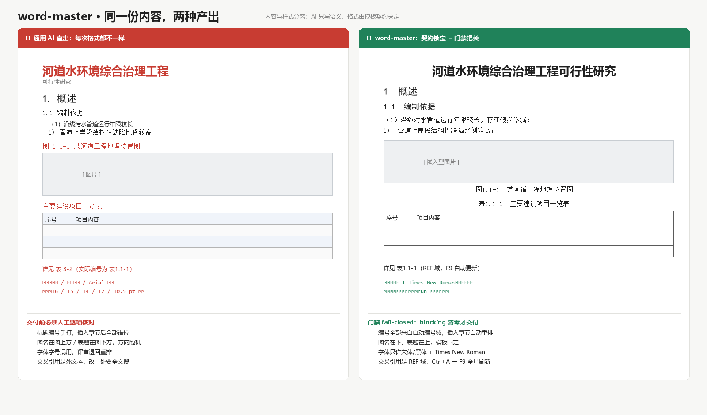

# word-master — Template-Driven Word Document Production Line

[](LICENSE)
[](CHANGELOG.md)
[](https://www.python.org/downloads/)

English | [中文](./README_CN.md)

> **Editable is the floor, not the goal — format stability is.** word-master hands you a *real* Word document: styles come from your organisation's own template stylesheet, numbers come from fields, figure and table captions number themselves — the AI writes content only and is not allowed to pick a single font size. Same shape as [ppt-master](https://github.com/hugohe3/ppt-master): a workflow (a "skill") that runs inside any agent-capable AI tool, on your machine, data never leaves your computer, no platform or model lock-in.

<p align="center">
  
</p>

<p align="center">
  <a href="#quick-start"><strong>Quick Start</strong></a> ·
  <a href="#why-word-master"><strong>Why word-master</strong></a> ·
  <a href="#how-it-works"><strong>How it works</strong></a> ·
  <a href="#documentation"><strong>Documentation</strong></a> ·
  <a href="#project-status"><strong>Project Status</strong></a>
</p>

---

## Why word-master

AI can already write the text. The problem is everything around the text: **every run produces a different document.** Heading sizes drift, numbering is typed by hand and breaks the moment you insert a chapter, table styles change between chapters, captions end up on the wrong side of the figure, and the reviewer sends it back for a full re-layout.

Existing options do not solve this:

| Approach | Why it falls short |
|---|---|
| Generic "docx skill" prompts | No style source of truth. The model guesses formatting every time. |
| Jinja2 / docxtpl mail-merge | Great for filling placeholders, no concept of a *document structure* — numbering, captions, cross-references all stay manual. |
| Markdown → Pandoc → DOCX | Produces a new, generic stylesheet. Your unit's template is thrown away. |
| "Just use Word's styles" | Correct in theory. In practice nothing enforces it, and one pasted paragraph breaks the chain. |

word-master fills exactly that gap: **a fixed template + a style library + a production line + a fail-closed quality gate**, aimed at engineering reports and technical documents.

## Product Positioning

**The output is not "an AI-written document" — it is a document that passes your unit's format review.** The pipeline produces a natively editable `.docx` whose every format decision is traceable to a `contract.json` derived from a real template your organisation uses.

That depth is a direction of travel, not a fixed checklist: word-master keeps converging with what Word itself can express — more style roles, more numbering schemes, more template packages — release after release.

In form, it is a workflow (a "skill") that runs inside any agent-capable AI tool: tell it in chat — "write a report from these materials" — and it runs on your machine and exports a natively editable `.docx`. You do exactly three things: install Python, install an AI tool, drop in your material.

On top of that, three promises:

- **Transparent, predictable cost** — free and open source; the only cost is your AI model usage, no Office subscription on top
- **Data stays local** — apart from AI model communication, the entire pipeline runs on your machine
- **No platform lock-in** — any agent-capable AI IDE or CLI can drive it; Claude, GPT, Gemini, Kimi, DeepSeek and others all work

> [!IMPORTANT]
> ### This is a tool, not a wishing well
> `harness + model = agent` — word-master only owns the workflow; the model sets the ceiling. A model that can follow a 60-line content grammar and hold a chapter outline will produce good documents; a cheap model will produce text that passes the gate but reads poorly.
>
> And do not expect a perfect deliverable in one shot. The tool's value is taking the tedious 80% off your plate — the remaining 20% (cover page, signature block, the judgement calls only a human can make) is yours. A natively editable DOCX exists precisely so you can keep working on it.

## How It Works

**Content and style are fully separated.** The AI produces semantic markup (`#` headings, `:::figure` blocks, `{{ref:fig:x}}` cross-references); every format decision is made by the template contract, applied by deterministic scripts, and verified by a blocking gate:

```
topic / sources ──▶ research (facts.json with provenance) ──▶ init + import ──▶ ⛔ confirm (template + outline)
               ──▶ AI writes content.md (pure semantics, zero formatting)
               ──▶ docx_builder.py injects into the template shell
               ──▶ doc_checker.py fail-closed gate ──▶ deliver (Ctrl+A → F9 in WPS)
```

Four ideas do the work:

- **Template packages are composable** — each package is a byte-preserved copy of the unit's original `.docx` + a cleaned build shell + a machine contract (`contract.json`) + a human contract + an unpacking analysis. Bring your unit's template in through the *Create Template* route.
- **The gate fails closed** — style whitelist (out-of-contract = blocked), headings and captions must come from auto-numbering fields, sub-level-7 sequence numbers must be hand-typed (a unit convention, so cross-document merging does not renumber), caption side is fixed (figure below, table above), font overrides are detected. Any `blocking` finding stops delivery.
- **Facts carry provenance** — every key figure gets a `fact_id`, source priority 国家政策 ＞ 政府发文 ＞ 法规 ＞ 新闻 ＞ 博客, and the source appendix is generated automatically at the end of the document.
- **Three routes, one contract** — Generate DOCX (new report), Create Template (ingest a unit template), Edit Native DOCX (targeted edits, everything else byte-preserved).

## Quick Start

### 1. Prerequisites

**All you need to install is [Python](https://www.python.org/downloads/) 3.10+.** Everything else comes with one line after you download the project:

```bash
pip install -r requirements.txt
```

**No Microsoft Office required** — WPS is enough. TOC and cross-reference fields refresh with `Ctrl+A` → `F9` after opening.

<details>
<summary><strong>Windows</strong> — notes for a clean setup</summary>

- During Python install, **check "Add python.exe to PATH"**.
- If `python` is not on PATH, the bundled scripts also work with the full path, e.g.
  `"%LOCALAPPDATA%\Programs\Python\Python312\python.exe" -X utf8 ...`
- Always run the scripts with `-X utf8` on a Chinese Windows install, otherwise console output can raise `UnicodeEncodeError`.
</details>

### 2. Pick an Agent

word-master runs in **any tool with agent capability** — read/write files, execute commands, sustain a multi-turn conversation.

| Type | Examples |
|---|---|
| **IDE-native agent** | [Cursor](https://cursor.sh/), [Windsurf](https://codeium.com/windsurf), VS Code with an agent, [Zed](https://zed.dev/) |
| **IDE plugin / extension** | [Claude Code](https://claude.ai/code) (VS Code / JetBrains), [GitHub Copilot](https://github.com/features/copilot), [Cline](https://cline.bot/) |
| **CLI agent** | [Claude Code](https://claude.ai/code) CLI, [Codex CLI](https://github.com/openai/codex), Gemini CLI, [pi](https://github.com/earendil-works/pi-mono) |

Never used one? In this project it plays exactly one role: an AI chat window that can read and write files. No coding involved.

### 3. Set Up

```bash
git clone https://github.com/NewRudy/word-master.git
cd word-master
pip install -r requirements.txt
```


#### Mirrors

Mirrored to [Gitee](https://gitee.com/hhhsbgitee/word-master), which is usually
faster than GitHub from mainland China. The mirror is push-only and may lag by a
few minutes; issues and pull requests belong on GitHub.

#### Updating later

```bash
git pull
pip install -r requirements.txt   # only when requirements.txt changed
```

### 4. Create

**Open the project folder in your agent** (IDE: File → Open Folder; CLI: `cd word-master` then launch the agent). Everything after this happens in chat.

**Option A — you have source material.** Put your DOCX / PDF / text into `projects/<your-project>/sources/` (create the folder, or let the agent run `project_manager.py init` for you), then say:

```
You: 用 projects/xxx/sources/材料.docx 写一份可行性研究报告
```

**Option B — you only have a topic.** Just say so; the agent researches first, records provenance in `facts.json`, and comes back with an outline for confirmation.

By default the agent confirms the spec before writing (this is a `⛔ BLOCKING` gate, it will not proceed on its own):

```
AI:  开始前先确认：
     [模板]   qiji_heading（七级标题工程报告）
     [大纲]   1 概述 / 2 建设必要性 / 3 建设内容 / 4 结论与建议
     [篇幅]   约 6000 字，3 图 2 表
     [事实]   需研究（国家政策优先）
```

**Quick generation (skip the confirmation round trip):** say so explicitly.

```
You: 快速生成，不用跟我确认
```

Whatever you state explicitly is followed; whatever you leave unspecified the agent decides itself. It still researches, applies the contract, and runs the gate — it drops the interaction, not the quality control.

> **Output:** the document lands in `projects/<project>/exports/<name>_<timestamp>.docx` as a natively editable DOCX. Every build gets a new timestamp; old versions are kept.
>
> **Something went wrong?** Ask the agent to read `skills/word-master/SKILL.md`; for everything else see the **[FAQ](./docs/faq.md)**.

### 5. Command Reference (to understand the machinery)

```bash
PY="python"   # Windows: "%LOCALAPPDATA%\Programs\Python\Python312\python.exe" -X utf8

"$PY" skills/word-master/scripts/template_manager.py list                    # list template packages
"$PY" skills/word-master/scripts/project_manager.py init <name>               # create a project
"$PY" skills/word-master/scripts/project_manager.py import-sources <proj> <src...>
"$PY" skills/word-master/scripts/project_manager.py validate <proj>           # check project integrity
"$PY" skills/word-master/scripts/docx_builder.py build <proj>                 # build
"$PY" skills/word-master/scripts/doc_checker.py check <proj> --json           # gate
```

Daily use does not require typing any of these — the agent runs them.

### 6. Pick a Template (or bring your own)

Four packages ship with the repo — the reference engineering-report template plus three derived variants:

| Package | For | Body font | Deepest heading |
|---|---|---|---|
| `qiji_heading` | engineering technical reports (reference, a real unit template) | 宋体 小四 | 7 |
| `gov_report` | government / public-sector reports | 仿宋 小四 | 5 |
| `acceptance_report` | acceptance and review reports | 宋体 小四 | 5 |
| `meeting_minutes` | meeting minutes, briefings | 宋体 小四 | 3 |

```bash
"$PY" skills/word-master/scripts/project_manager.py init 我的报告 --template gov_report
```

Need a variant that differs only in role styles or heading depth? Derive one in seconds:

```bash
"$PY" skills/word-master/scripts/template_derive.py qiji_heading my_template     --desc "我的单位报告模板：四级标题、楷体正文"     --max-heading-level 4     --set-role "body:font=楷体,Times New Roman;size=14"
```

The derivation tool validates the resulting OOXML (every part parses, `python-docx` opens it, every contract role points at a real style) and fails loudly instead of writing a broken package. Full reference: [`templates/README.md`](skills/word-master/templates/README.md).

### 7. Bring In Your Own Template (optional but this is the point)

If your unit has a mandated `.docx` template, ingest it once:

```bash
"$PY" skills/word-master/scripts/template_manager.py analyze 你的模板.docx --out /tmp/tpl
"$PY" skills/word-master/scripts/template_manager.py install 你的模板.docx my_unit_template
```

Then ask the agent to finish the *Create Template* route: it reviews the derived contract with you (`⛔ BLOCKING`), produces the cleaned shell, and writes `template_contract.md`. From then on every report uses your unit's stylesheet.

---

## Documentation

| | Document | Description |
|---|---|---|
| 📘 | [SKILL.md](./skills/word-master/SKILL.md) | Global discipline, hard rules, route entry point |
| 🧭 | [Routing](./skills/word-master/workflows/routing.md) | How to pick one of the three routes |
| 🛠️ | [Generate DOCX](./skills/word-master/workflows/generate-docx.md) | Step 1–7 main pipeline |
| 📦 | [Create Template](./skills/word-master/workflows/create-template.md) | Unit `.docx` → template package |
| ✏️ | [Edit Native DOCX](./skills/word-master/workflows/edit-native-docx.md) | Targeted edits, everything else byte-preserved |
| 📐 | [Content Grammar](./skills/word-master/references/content-grammar.md) | The complete `content.md` syntax |
| 📚 | [Template Library](./skills/word-master/templates/README.md) | Shipped packages, derivation, how to add one |
| 🏗️ | [Scripts](./skills/word-master/scripts/) | project / template / builder / checker / derive |
| 💼 | [Demo Project](./projects/_demo/) | End-to-end example, gate passes |
| ❓ | [FAQ](./docs/faq.md) | Model choice, cost, troubleshooting |
| 🆚 | [Why word-master](./docs/why-word-master.md) | Where it fits, where it does not |

---

## Project Status

**v0.2.0** — three routes + four template packages (one reference, three derived) + builder + fail-closed gate, end-to-end demo passing.

Roadmap: confirmation UI (staged interaction) → PDF-to-text sources → WPS COM field refresh → more template packages (bid, annual report, test report) → data-driven charts.

## Contributing

Issues and PRs are welcome. New template packages must go through the *Create Template* route: `template_src.docx` byte-intact, both contract files (`contract.json` + `template_contract.md`) in sync. See [CONTRIBUTING.md](./CONTRIBUTING.md).

## License

[MIT](./LICENSE)

## Acknowledgments

- [ppt-master](https://github.com/hugohe3/ppt-master) — the architectural blueprint and inspiration (routed skill package, gate discipline, engineering management all follow its design)
- [python-docx](https://github.com/python-openxml/python-docx)

## Sponsor & Support

word-master is free and open source and always provider-neutral. If it saves you a re-layout, consider supporting its maintenance — see [SPONSORING.md](./SPONSORING.md).
